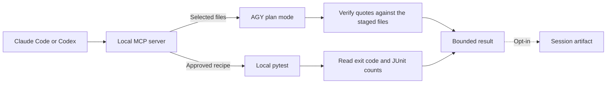

# Delegate documents and tests

Send a focused question or a named test recipe from Claude Code or Codex. The bridge returns a compact result with a status, a summary, and evidence you can check.



## Set up a trusted workspace

From a checkout of the release source, install the bridge and the test extra into a local environment. Register the `agy-mcp-server` executable from that environment or activate the environment before launching the client.

```bash
python -m pip install -e ".[dev]"
agy-mcp-server --help
```

For a packaged release, use an exact version in the registration. Set `BRIDGE_VERSION` to the published version that includes these tools and `WORKSPACE` to an absolute path. These commands use POSIX shell variables. In PowerShell, use `$env:BRIDGE_VERSION` and `$env:WORKSPACE` or substitute the values directly.

```bash
codex mcp add antigravity-delegation -- uvx \
  --from "agy-headless-bridge[dev]==${BRIDGE_VERSION}" agy-mcp-server \
  --delegation-root "$WORKSPACE" --enable-pytest --retain-delegation-artifacts
```

```bash
claude mcp add --transport stdio antigravity-delegation -- uvx \
  --from "agy-headless-bridge[dev]==${BRIDGE_VERSION}" agy-mcp-server \
  --delegation-root "$WORKSPACE" --enable-pytest --retain-delegation-artifacts
```

For a trusted Codex project, you can put the equivalent configuration in `.codex/config.toml`. Replace both placeholders with literal values. Use forward slashes in Windows paths.

```toml
[mcp_servers.antigravity-delegation]
command = "uvx"
args = ["--from", "agy-headless-bridge[dev]==<published-version>", "agy-mcp-server",
        "--delegation-root", "<absolute-workspace>", "--enable-pytest",
        "--retain-delegation-artifacts"]
```

Open a new client session and confirm it lists `agy_preflight`, `agy_summarize_document`, `agy_run_tests`, and `agy_read_artifact`. Claude Code plugin users can invoke `/agy-headless-bridge:agy-delegation` after registering this scoped server.

### What the tools can access

- `--delegation-root` authorizes this MCP connection to select Markdown, text, `.log` or `.out` files under that directory. Log files with invalid UTF-8 are staged with replacement characters. The bridge copies up to four UTF-8 files and 4 MiB total into a temporary attachment. The selected content goes to the AGY service under your AGY account. Choose files you can share with that service.
- AGY reads about 3,000 lines per document call. Notes up to roughly 2,000–3,000 lines are read in full. For larger notes AGY samples line ranges, so a fact outside those ranges can be missed. In testing, AGY listed the unread ranges under gaps. Split very large notes or ask a focused question.
- `agy_inspect_media` copies up to four PNG or MP4 files, 64 MiB total, into a temporary attachment for AGY. Each claim carries an image or timestamp locator; the bridge checks the file and locator format, not the claim itself.
- `--enable-recipe ruff`, `npm-test` or `cargo-test` (repeatable) approves more fixed `agy_run_tests` recipes. The tool schema lists only the recipes you enabled.
- `--enable-pytest` approves `python -m pytest` with fixed report arguments in that workspace. Project tests, fixtures, and plugins execute locally with your user's permissions and may write caches or build outputs. Enable this on a workspace whose tests you trust.
- The delegation tools use a trusted local MCP connection. AGY plan mode is a CLI setting. This registration is incompatible with the bridge's guarded launcher flags.
- Omit `--enable-pytest` or `--retain-delegation-artifacts` when you only need document summaries. Existing general-purpose AGY tools retain their own workspace and permission settings.

## Demo 1 · Check a source quote

Use an empty demo directory as `WORKSPACE` and copy [relay.md](../tests/fixtures/delegation/relay.md) into it. Send this to the host:

> Call `agy_preflight` first. If it succeeds, use `agy_summarize_document` on `relay.md`. Ask for the frame cap and whether the note gives a rollback procedure. Return the cited line and the coverage gap.

`agy_preflight` checks the local CLI version, `--json-schema` support, and the model catalog without asking a model to generate an answer. The default is `gemini-4-hydrogen-low`. Pass an exact `model` ID to both calls to choose another model. A catalog entry can be present while inference requires sign-in or has exhausted quota. The tool reports those outcomes when the CLI identifies them.

Expect **65,536 bytes** with a verbatim quote from line **4** and a gap for the unspecified rollback procedure. The bridge verifies that the quoted text occurs within the cited lines. It labels results with missing or unverified references `partial`.

## Demo 2 · Keep the failing test ID

Copy [noisy_pytest.py](../tests/fixtures/delegation/noisy_pytest.py) into the demo directory as `test_relay.py`. Keep this deliberately failing test out of your regular suite. Send this to the host:

> Use `agy_run_tests` with recipe `pytest`, `retain: true`, and `max_chars: 800`. Report the exit code and failed test. Use `agy_read_artifact` for lines 20 through 25 if a log excerpt is needed.

Expect exit code **1**, one failed test, and the ID `test_relay.py::test_relay_contract`. The bridge takes counts from the pytest JUnit report when available and returns a short failure excerpt. A routine run makes zero AGY inference calls. On a failure, `summarize: true` sends a bounded log excerpt to AGY and keeps the original `facts` even if inference fails.

## Control response size

| Output | Maximum default size | Availability |
| --- | ---: | --- |
| `summary` | 2,000 characters | Default |
| `standard` | 4,000 characters | Request per call |
| `full` | 8,000 characters | Start the server with `--enable-full-delegation-output` and request per call |

Use `max_chars` to lower a level's limit, down to 512 characters. These limits count compact serialized result characters. The server budgets for both the text and structured copies when the connection negotiates MCP `2025-06-18`. Host-added wrappers and model tokens vary by client. Older MCP clients receive the text result. The `truncated` flag indicates the bridge reduced the result to fit the budget.

Artifacts require `--retain-delegation-artifacts` and `retain: true`. The server stores up to eight in memory, with a 64 KiB limit per artifact. Each ID expires after ten minutes and only works on the MCP connection that created it. `agy_read_artifact` accepts one-based ranges of up to 100 lines and applies the same response budget to the excerpt. The artifact may expire, be evicted, or be unavailable if it exceeded its size limit.

## Run jobs together and follow progress

The server can run two independent read-only calls at a time. Use `--jobs 1` to serialize all calls. Pytest and workspace-attached `agy_ask` calls run exclusively. Requests that resume the same AGY conversation run in order. The server returns a busy result if eight calls are already outstanding.

Clients can request MCP progress notifications with a `progressToken`. The bridge sends at most one update every five seconds. In direct mode with AGY 1.5.18 or newer, an update can report observed AGY activity from a tool or response step. PTY and older versions report elapsed time. A client's cancellation stops its job, including the process tree where the platform supports it.

## Opt in to Git inspection and public research

Enable `--enable-git` on a trusted Git worktree to register `agy_git_diff`. Choose a local `baseline` such as `HEAD` or a commit ID and optionally pass relative `paths`. The tool returns the verified HEAD and baseline, counts of tracked changes including renames, and a bounded diff excerpt. It omits untracked files and submodule internals. Git uses the worktree's local filters. Set `summarize: true` to send the excerpt to AGY for analysis. When the response needs trimming, the bridge shortens the excerpt before trimming the requested analysis. Set `review: true` instead to get findings tied to changed lines; the bridge keeps only findings on complete added lines in the excerpt it sent.

Enable `--enable-code-search` to register `agy_find_code`. Pass a `question` and optional relative `paths` (up to eight). AGY can read every file in the selected scope, the whole workspace by default, including untracked files such as `.env`. The bridge verifies each returned `file:line` citation against the workspace and drops citations outside the selected scope. Enable it only for workspaces whose contents may go to Google.

Enable `--enable-public-research` to register `agy_public_research`. Pass a `question` and `network: true` per call. AGY starts in a disposable directory with no workspace attachment and receives instructions to read public sources. The result reports source URLs, the claims they support, and gaps. The bridge checks the shape of the URLs. Check the cited pages to verify claims.
