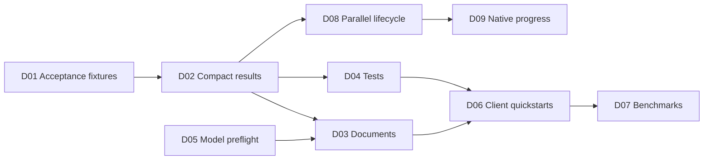

# Claude Code and Codex delegation backlog

The first release slice helps a caller summarize a long document or run a noisy failing test without loading the source or full log into its context. The caller gets a short answer it can verify. The [integration analysis](INTEGRATION_AND_COMPETITIVE_ANALYSIS.md) describes the verified v1.4.0 baseline and the competitive evidence.

D01–D06 cover the initial workflows, native client setup, and client-visible result measurements. The [delegation guide](DELEGATION.md) contains the demos. The diagram shows the main dependencies.

## P0 — First shippable workflows

### D01 — Establish two offline acceptance fixtures

- [x] Add a deterministic Markdown fixture. Verify the scoped attachment, focused question, source quote, line range, and rollback gap.
- [x] Add a noisy pytest fixture. Assert that the exit code and failure ID survive the response cap and that artifact reads return a bounded excerpt.
- [x] Run both fixtures red before implementing the workflows. The acceptance suite runs without AGY authentication or network access.

### D02 — Define and enforce compact result and artifact contracts

**Depends on D01.** Add the contract through a new opt-in path. Keep existing `agy_ask`, `agy_research`, CLI, and Python callers compatible.

- [x] Return a status, summary, bounded evidence and gaps, observed facts, and an optional artifact ID. Negotiated MCP `2025-06-18` clients get text and structured output. Regression tests cover the established `agy_ask` and `agy_research` response shapes.
- [x] Ship `summary`, `standard`, and explicitly enabled `full` with 2,000, 4,000, and 8,000-character limits. Callers can request less.
- [x] Gate artifact retention on explicit server and caller opt-in. Enforce ID scope, expiry, size limits, and bounded line reads.
- [x] Cover Unicode, malformed summaries, oversized diagnostics, denials and quota, disabled retention, missing artifacts, and cross-session denial.
- [x] Measure which result copies both native hosts expose to their models. Measure caller tokens in D07.

### D03 — Summarize a long document with verifiable references

**Depends on D02 and D05.** Start with local Markdown and plain text.

- [x] Stage scoped Markdown and text paths from a registered workspace and send AGY a focused question. Treat document contents as source material.
- [x] Use AGY `--json-schema` for summaries, references, and gaps. Verify paths and verbatim quotes against staged files. Return bounded partial or error results when output or references are unavailable.
- [x] Pass the offline D01 document fixture and the Windows stdio smoke with AGY 1.5.18. Hydrogen Low returned the frame cap at line 4 and the rollback gap. Both serialized representations totaled 1,246 characters.
- [x] Run the synthetic document in both native hosts on Windows during D06.
- [ ] Verify document reads against native, authenticated AGY on POSIX. WSL passed the offline workflow fixtures.

### D04 — Run configured tests and preserve execution facts

**Depends on D02.** Use a local runner for a named, preconfigured test recipe. Start with the repository's own pytest workflow.

- [x] Run server-approved pytest with fixed arguments and working directory. Return observed status, exit code, elapsed time, JUnit counts when available, and the first failing ID and bounded excerpt.
- [x] Exercise passing, noisy failing, and timeout runs. Invoke AGY on a failing excerpt only when requested, and retain the process outcome when inference fails.
- [x] Document pytest caches and other possible writes. Runtime overlap remains in D08.

### D05 — Verify prerequisites and support an explicit Hydrogen preset

- [x] Check CLI availability, version, schema support, and catalog readiness with bounded probes. Default to `gemini-4-hydrogen-low` and accept an exact model ID.
- [x] Report actionable outcomes for missing CLI, incompatible features, unavailable models, authentication, and quota. Preserve the selected model through errors and cover the branches with offline fixtures.

### D06 — Package native onboarding and the two demos

**Depends on D03 and D04.**

- [x] Document version-pinned Codex and Claude Code registrations, trusted-project settings, preflight, and two demo prompts. Bundle a Claude Code skill that calls MCP directly.
- [x] Smoke test a fresh install, tool discovery, the Markdown summary, and the noisy failing test in native Codex. Record model-visible response sizes and results.
- [x] Run both demos in native Claude Code and record model-visible response sizes and results.
- [ ] Release gate for the first slice is green offline tests plus the documented client smokes. Any public claim about measured token savings depends on D07.

The Windows smoke used Codex CLI 0.172.0 with `gpt-6.2-sol`, AGY 1.5.18, and a freshly installed local preview wheel with package metadata `1.4.0`. Only the synthetic fixtures were in the delegation workspace. The document call used `gemini-4-hydrogen-low`. Preflight queried the catalog, and pytest and artifact retrieval ran locally.

| Codex tool | Result | MCP result copies (chars) | Serialized result in model input (chars) |
| --- | --- | ---: | ---: |
| `agy_preflight` | `ok`, default model available in catalog | 312 | 390 |
| `agy_summarize_document` | `ok`, verified 65,536-byte cap at line 4 and missing rollback procedure at line 11 | 1,216 | 1,328 |
| `agy_run_tests` | `failed`, exit 1, `test_relay.py::test_relay_contract` | 642 | 738 |
| `agy_read_artifact` | `ok`, bounded excerpt for lines 20–25 in a follow-up smoke | 600 | 682 |

The Codex transcript contained both the text and structured copies. The serialized result sizes include JSON fields and escaping.

Claude Code 2.1.332 with `claude-haiku-5-5` ran the same fixtures on Windows from the fresh preview install. Its model-facing `tool_result` contained one text copy. The native event recorded the matching `structuredContent` in diagnostic metadata outside that block.

| Claude Code tool | Result | MCP result copies (chars) | Serialized `tool_result` (chars) |
| --- | --- | ---: | ---: |
| `agy_preflight` | `ok`, Hydrogen Low listed | 312 | 256 |
| `agy_summarize_document` | `ok`, cap at line 4 and rollback gap at line 11 | 1,400 | 834 |
| `agy_run_tests` | `failed`, exit 1, `test_relay.py::test_relay_contract` | 642 | 439 |
| `agy_read_artifact` | `ok`, bounded excerpt for lines 20–25 | 600 | 404 |

## P1 — Prove savings and expand usage

### D07 — Publish a reproducible benchmark

**Depends on D06.**

- [x] Compare the same long document, noisy failing tests, and a small-task control across native Claude Code and Codex, filtered outputs, native subagents for the document, and bridge delegation.
- [x] Measure host input and output, cache reads, response size, wall time, and retries. Grade source claims and execution facts. Record AGY call counts and the limits of provider telemetry. The optional artifact read has separate D06 measurements.
- [x] Publish the runner, synthetic fixtures, and observed results, including cases where delegation loses. [Benchmark and reproduction steps](DELEGATION_BENCHMARK.md)

### D08 — Run two independent jobs with predictable cleanup

**Depends on D02.**

- [x] Keep reading MCP messages while jobs run and serialize protocol writes. Cap independent read-only jobs at two by default with `--jobs 1` available. Bound admission to eight outstanding calls, serialize potential writes and same-conversation resumes, and give scoped document calls independent staging directories.
- [ ] Wire cancellation, server shutdown, and hard and idle timeout behavior to owned child cleanup. Exercise the direct and PTY paths with process-tree fixtures on the Windows and POSIX platforms the feature will claim to support. Account for completion and cancellation races, and release slots after every terminal state.
- [x] Demonstrate overlapping execution and a responsive connection. Windows stdio returned a ping within 0.56 s while both independent AGY jobs ran and returned the expected marker at 28.34 and 30.83 s. The deterministic lifecycle fixture cancels queued and running jobs while independent work completes. Each parallel response has its own cap and a server accepts at most two active callbacks.

### D09 — Surface quiet, observable progress

**Depends on D08.**

- [x] Evaluate AGY `stream-json` against fixtures for step, result, error, and incomplete output. Use observed steps in direct mode with AGY 1.5.18 or newer. PTY and older CLI versions report elapsed time.
- [x] Use the client's `progressToken` and cap updates at one every five seconds. Send short messages for elapsed time and observed child activity. Keep hard deadlines independent of progress. Keep command output and model deltas out of notifications.
- [ ] Verify interactive cancellation and visible rendering in both hosts. Claude Code and Codex print-mode smokes sent progress tokens and received five MCP notifications each. Both received the three-second bridge timeout result. Both also sent `notifications/cancelled` when a separate eight-second client deadline expired. The stdio lifecycle fixtures verify cleanup independently of native UI behavior.

### D10 — Add read-only Git and public-source research

**Depends on D02 and D06.** Keep the two workflows independently shippable.

- [x] Git reports the verified revision, change counts, and a bounded excerpt for project-configured tracked diffs. Tests cover clean, dirty, rename, and scoped cases. Optional AGY synthesis receives the selected diff excerpt.
- [x] Research returns a bounded answer with cited URLs and unresolved gaps. Network access is explicit and AGY runs in an empty directory without a workspace attachment. The Windows smoke checked both the symbolic branch ref and the detached-HEAD exit status against the official manual. [Git symbolic-ref](https://git-scm.com/docs/git-symbolic-ref)

## P2 — Expand based on observed demand

- [ ] **D11 · Smarter routing.** Use D07 and the laptop workflow study to define task thresholds, preferred model profiles, and optional routing. D07 supports direct reads for small lookups and filters for known patterns. It shows no stable token break-even threshold for automatic routing. The existing model preflight accepts exact user choices and reports model unavailability or quota without silent substitution.
- [ ] **D12 · Isolated writes.** Require a verified permission boundary, task-scoped worktree, caller-approved action scope, and a reviewable diff with test results. Test denied writes outside the boundary and interruption before advertising unattended writes. Keep push, merge, and publish under explicit caller control.
- [ ] **D13 · Additional transports.** Consider HTTP or an OpenAI-compatible adapter when a named client cannot use stdio MCP or the CLI. Define the required protocol behavior, trust boundary, and client acceptance test before implementation.

## Next-session starting point

Finish the pending client and platform checks before claiming support for those combinations. D12 requires a verified isolation launcher and D13 requires a named client. The pytest worker-count project tracks a separate repository optimization.
